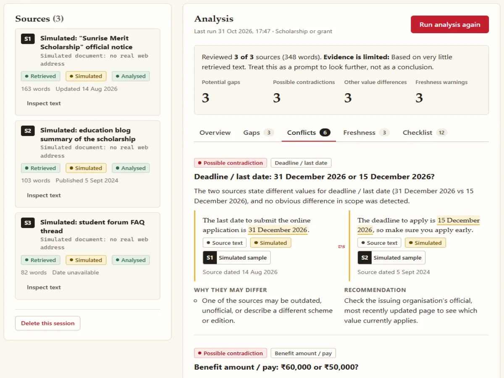
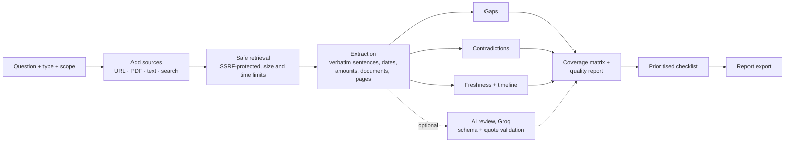
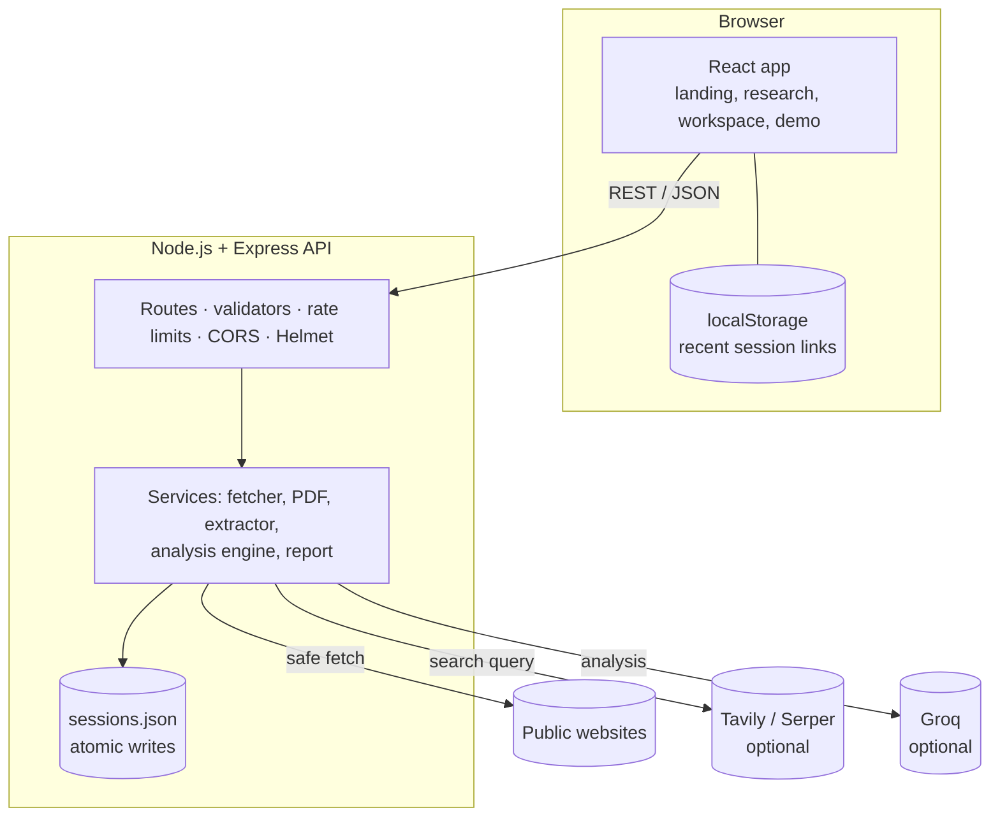

<div align="center">


# Digital Dark Spot

### Find what the sources leave out.

An evidence-first research platform that reviews the sources you collect and shows **what is missing**, **what conflicts**, and **what may be outdated**, with the evidence behind every finding and a checklist of what to verify next.

Built for the **Shinchan Online Hackathon 2026** · Problem statement: *Digital Dark Spot: AI-Assisted Information Gap Detection Platform*


</div>

<p align="center">
  
  <br />
  <sub>The real workspace running the built-in sample investigation (simulated sources).</sub>
</p>

---

## Table of contents

1. [The problem](#the-problem)
2. [The solution](#the-solution)
3. [Key features](#key-features)
4. [Judge demo script](#judge-demo-script)
5. [How the analysis works](#how-the-analysis-works)
6. [What makes it different](#what-makes-it-different)
7. [Evidence and transparency](#evidence-and-transparency)
8. [Architecture](#architecture)
9. [Getting started](#getting-started)
10. [Configuration](#configuration)
11. [API reference](#api-reference)
12. [Security](#security)
13. [Privacy](#privacy)
14. [Testing and evaluation](#testing-and-evaluation)
15. [Known limitations](#known-limitations)
16. [Future scope](#future-scope)

---

## The problem

People make important decisions about scholarships, jobs, public services and research using information scattered across many websites and documents. That information is often:

- **Incomplete**: eligibility is explained, but renewal conditions or the document list are not.
- **Contradictory**: an official notice and a blog give different deadlines or amounts.
- **Outdated**: a forum answer describes last year's application cycle, with no date on the page.

Search engines help you *find* pages. Summarisers *condense* them. Neither tells you **what is missing**, **where sources disagree**, or **what you still need to verify** before you act.

## The solution

Digital Dark Spot turns a research question and a set of sources into an inspectable investigation:

1. **Collect.** Ask a question, optionally set your scope (situation, location, time period), and add sources: web pages, PDF links, uploaded PDFs, pasted text, or web-search results when a search provider is configured.
2. **Investigate.** The server retrieves each source and extracts relevant statements word for word. The analysis reports potential gaps, possible contradictions, freshness warnings, a coverage matrix and an investigation-quality report.
3. **Verify.** Every finding links to its evidence and becomes a prioritised checklist item. Export the full report as Markdown or a printable page.

> Findings are prompts for verification, not verdicts. The platform says *"not found in the sources reviewed"*, never *"this does not exist"*.

## Key features

| Feature | What it does |
| --- | --- |
| **Research sessions** | A question, a research type (scholarship, job, public service, research, general, or auto-detect) and an optional scope. Sessions persist and can be reopened from the same device. |
| **Four ways to add sources** | Web page URL (HTML, plain text or PDF links), **PDF upload** with page-by-page extraction, pasted text, and **web search** (Tavily or Serper) when configured. Up to 10 sources per session. |
| **Source manager** | Title, link or file name, retrieval status and timestamp, declared dates, word and page count, official-domain signal with its basis, retry, removal, and a flag when content changed since the last analysis. |
| **Potential gap detection** | Topics the research type needs that no reviewed source covers, values mentioned without specifics, critical topics backed by one source, a year or place in your scope that no source mentions, and parts of your question that go unaddressed. |
| **Contradiction analysis** | Deadlines, amounts, fees, age and income limits, marks and required-document lists compared across sources. Classified as possible contradiction, document lists differ, different cycle, different scope, different units, **inconclusive** (for example an ambiguous date such as 05/06/2026) or **not directly comparable** (for example different currencies). |
| **Freshness and timeline** | Profile-specific thresholds (12 months for scholarships, jobs and public services; 24 for general; 60 for academic). These are warning rules, not proof of error. Passed deadlines and implausible future dates are flagged, undated sources are reported as "publication date not established", and a timeline marks today's date. |
| **Evidence inspector** | Every citation opens the full retrieved text with the passage highlighted, with page numbers for PDFs and a link to the live page. |
| **Research coverage matrix** | Topics against sources with a status per topic (covered, one source only, not found, conflicting, differs by cycle or scope). Every cell opens its evidence. |
| **Investigation quality report** | An explained factor list (sources reviewed, independent publishers, topics covered, critical gaps, single-source topics, official-domain sources, recent dates). Deliberately no single score. |
| **Verification checklist** | Prioritised tasks with a reason, related finding, sources, and where to check. Ticking an item is labelled "marked done by you", never "verified". Users can add, reopen and delete their own items. |
| **Report export** | Markdown download or printable HTML of the actual session, including sources, findings, quotes, checklist, AI labels and methodology. |
| **Optional AI review** | With a Groq key: a summary, extra gap suggestions and a second opinion on conflicts. Labelled as AI, schema-validated, and every quote is checked word for word against the source. |
| **Guided sample investigation** | `/demo`: a reproducible, offline-safe walkthrough on clearly labelled simulated sources, with a one-click reset. |

## Judge demo script

About three minutes. Everything shown is the live application.

| Step | Action | What to point out |
| --- | --- | --- |
| 1. Problem | Open the landing page | Search and summaries don't show what is missing. |
| 2. Question | Click **Explore a sample investigation** → **Start the sample investigation** | The question from the official problem statement: *"What should I verify before applying for this scholarship?"*. The sources are labelled **Simulated**. |
| 3. Sources | Look at the Sources panel | An official notice (dated), a blog (2 years old) and a forum thread (undated). |
| 4. Analysis | Guided demo → **Run analysis** | Scope line: 3 of 3 sources reviewed, evidence strength stated honestly. |
| 5. Gap | **Show gap** | *Renewal conditions: not found in the sources reviewed*, with the wording searched and the sources checked. |
| 6. Conflict | **Show conflict** | 31 December vs 15 December side by side with both quotes. The forum's 2024 deadline is classed as *a different cycle*, not a contradiction. Document lists differ: income certificate vs salary slips or ITR. |
| 7. Freshness | **Show freshness** | Blog beyond the 12-month threshold, a passed deadline, an undated forum, and the timeline. |
| 8. Evidence | **Open evidence** | The exact sentence highlighted inside the full source text. |
| 9. Checklist | **Open checklist**, tick an item | Prioritised, explained tasks. The tick reads *Marked done by you*, not *verified*. |
| 10. Report | **Download report (.md)** or **Printable report** | The exported report of this exact session. |
| 11. Real data | **Start research** with a real question and a real URL or PDF | Same workflow on live sources; PDF findings cite page numbers. |

## How the analysis works



| Stage | Code | Details |
| --- | --- | --- |
| Retrieval | `backend/src/services/fetcher.service.js`, `pdf.service.js` | DNS-pinned connections, every redirect re-validated, 12 s timeout, 3 MB HTML / 10 MB PDF limits, content-type checks. Cookie walls, JavaScript notices and bot checks are reported as not retrieved. PDFs: magic-byte check, 200-page limit, 20 s timeout, no OCR. |
| Extraction | `analysis/claims.js` | Sentences tagged by topic; dates, money (including lakh and crore), ages and percentages parsed; PDF page numbers attached. Text is never paraphrased. |
| Gaps | `analysis/gaps.js`, `analysis/insights.js` | Profile topics with importance and verification steps; scope checks for years and places; question-coverage check that ignores generic words. |
| Contradictions | `analysis/contradictions.js` | Compared only when each sentence states one explicit value. Cycle, unit and category differences are classified separately; ambiguous dates are inconclusive and different currencies are not comparable. Document lists are compared by document type. |
| Freshness | `analysis/freshness.js` | Declared dates only; profile thresholds; passed deadlines; inferred years kept separate from publication dates. |
| Insights | `analysis/insights.js` | Coverage matrix statuses, timeline, investigation-quality factors. |
| Checklist | `analysis/checklist.js` | Prioritised tasks with a destination (official-domain source in the session, or a suggested search); completion survives re-analysis. |
| AI review | `services/ai.service.js` | Optional; delimited untrusted source text; strict output validation; unverifiable quotes discarded. |
| Report | `services/report.service.js` | Markdown and escaped printable HTML of the actual session. |

## What makes it different

- **It reports absence.** The core output is what the sources *don't* say, relative to what your type of decision needs and the scope you set.
- **Deterministic first, AI second.** The rule engine works without any key, and every finding traces to a sentence or a stated search scope.
- **Careful about conflicts.** A different deadline in a different year is *"may be a different cycle"*, not *"contradiction"*.
- **AI output is checked against the sources.** Quotes the model returns must exist in the retrieved text, or they are dropped.
- **Honest about coverage.** Sources reviewed, words read, failed retrievals, publisher diversity and official-domain presence are shown, not hidden behind a score.
- **Reproducible.** Each analysis records the engine version and a content hash and retrieval time per source, so a changed source is distinguishable from a changed analysis.

## Evidence and transparency

| Label | Meaning |
| --- | --- |
| **Source text** | Copied word for word from a retrieved source (with page number for PDFs). |
| **Search snippet** | Returned by the search provider; not evidence until the page is added and retrieved. |
| **AI-generated, unverified** | Written by a language model (only when AI review is enabled). |
| **Quote verified in source** | An AI key point whose quote was found word for word in the source. |
| **Simulated** | Demonstration content that is not real. |
| **Official / Academic domain** | The domain is reserved for such publishers. Shows the publisher type only, not currency or correctness. |
| **Publication date not established** | The source declares no date. It is not assumed to be outdated. |
| **Marked done by you** | A checklist item you ticked. The tool has not verified it. |

## Architecture



```text
backend/
  server.js                 startup: env validation, store load, retention purge
  src/app.js                Express app: Helmet, CORS, JSON limits, routes, errors
  src/config/               configuration and startup validation
  src/routes/ controllers/  REST endpoints
  src/services/             fetcher, pdf, extractor, source, search, report, store, ai, demo
  src/services/analysis/    profiles, claims, gaps, contradictions, freshness, insights, checklist
  src/validators/ middleware/ utils/
  test/                     unit, API, reliability tests and evaluation fixtures
frontend/
  src/pages/                Home, Research, Workspace, Demo, Method, Privacy, Terms, 404
  src/components/           UI primitives, forms, workspace (sources, findings, coverage, timeline, checklist, export, inspector)
  src/services/             API client (all backend calls)
  src/hooks/ styles/ utils/
  scripts/e2e.mjs           browser end-to-end check
```

## Getting started

**Prerequisites:** Node.js **22.9 or newer**, npm.

```bash
# Backend (http://localhost:4000)
cd backend
npm install
cp .env.example .env
npm run dev
```

```bash
# Frontend (http://localhost:5173)
cd frontend
npm install
cp .env.example .env
npm run dev
```

On start, the backend prints whether AI review and web search are enabled. Open http://localhost:5173.

**Production:** `cd backend && npm install --omit=dev && npm start`, and `cd frontend && npm run build` (static files in `frontend/dist`). No deployment configuration is included because no hosting platform has been chosen. Whichever static host you use must rewrite unknown paths to `index.html` (SPA fallback), otherwise `/research/...` links return 404 on reload. Configure HTTPS at the hosting platform or reverse proxy. Set `NODE_ENV=production`, `FRONTEND_ORIGIN`, `TRUST_PROXY` (backend) and `VITE_API_BASE_URL`, `VITE_SITE_URL` (frontend, before building). The frontend build prints a warning if `VITE_API_BASE_URL` still points to localhost. The JSON data file must live on persistent disk; hosts with ephemeral filesystems lose sessions on restart.

## Configuration

### Backend (`backend/.env`)

| Variable | Default | Description |
| --- | --- | --- |
| `PORT` | `4000` | API port |
| `NODE_ENV` | `development` | `production` enables HSTS and HTTPS origin checks |
| `FRONTEND_ORIGIN` | `http://localhost:5173` | Comma-separated CORS allow-list |
| `TRUST_PROXY` | `0` | Reverse proxies in front of the API (for rate limiting) |
| `SESSION_RETENTION_DAYS` | `30` | Sessions unchanged this long are deleted |
| `MAX_PDF_MB` | `10` | PDF upload and download limit |
| `GROQ_API_KEY` | *(empty)* | Enables the optional AI review |
| `GROQ_MODEL` | `openai/gpt-oss-120b` | Groq model with JSON mode |
| `SEARCH_PROVIDER` | *(empty)* | `tavily` or `serper`; empty uses whichever key is set |
| `TAVILY_API_KEY` | *(empty)* | Key from tavily.com |
| `SERPER_API_KEY` | *(empty)* | Key from serper.dev (Google results) |

The server validates configuration at startup: invalid values stop it with a clear message, and questionable ones print warnings. Secret values are never printed.

### Frontend (`frontend/.env`)

Public values only; everything here is bundled into the browser.

| Variable | Description |
| --- | --- |
| `VITE_API_BASE_URL` | Backend URL, default `http://localhost:4000` |
| `VITE_SITE_URL` | Deployed URL; enables canonical/OG URLs and `sitemap.xml`. Leave empty until known. |

### Enabling optional integrations

- **AI review:** set `GROQ_API_KEY` and restart the backend.
- **Web search:** set `SEARCH_PROVIDER=tavily` with `TAVILY_API_KEY`, or `SEARCH_PROVIDER=serper` with `SERPER_API_KEY`, then restart. Both providers offer free tiers (check their current limits). Without a key, the Search tab says so and manual sources keep working. No results are ever simulated.

## API reference

Base URL `http://localhost:4000/api`. Errors use `{ "error": { "code", "message", "fields?" } }`.

| Method | Endpoint | Description |
| --- | --- | --- |
| `GET` | `/health` | Status, engine version, AI and search configuration, limits |
| `POST` | `/research` | Create a session `{ question, profile?, context?: { situation, location, period } }` |
| `POST` | `/research/demo` | Create a sample investigation (simulated sources) |
| `GET` / `PATCH` / `DELETE` | `/research/:id` | Read, update question/type/scope, delete |
| `POST` | `/research/:id/sources` | Add `{ type: "url", url }` or `{ type: "text", title, text, originUrl? }` |
| `POST` | `/research/:id/sources/pdf` | Upload a PDF (`Content-Type: application/pdf`, `X-File-Name` header) |
| `POST` | `/research/:id/search` | Web search `{ query }` (503 `search_not_configured` without a provider) |
| `GET` / `DELETE` | `/research/:id/sources/:sourceId` | Full source text / remove |
| `POST` | `/research/:id/sources/:sourceId/retry` | Retry a failed retrieval |
| `POST` | `/research/:id/analyze` | Run the analysis |
| `GET` | `/research/:id/findings` | Latest analysis |
| `GET` | `/research/:id/report?format=markdown\|html` | Export the report |
| `GET` / `POST` | `/research/:id/checklist` | Read / add your own item |
| `PATCH` / `DELETE` | `/research/:id/checklist/:itemId` | Mark done `{ done }` / delete your own item |

## Security

- **Secrets stay server-side.** Groq and search keys are read only by the backend; the frontend bundle contains no credentials.
- **SSRF protection:** http/https on ports 80 and 443 only, no embedded credentials, local hostnames and numeric IP spellings blocked. Connections are pinned to DNS results checked against private, loopback, link-local (including `169.254.169.254`), CGNAT, reserved and multicast ranges for IPv4 and IPv6 (including mapped and NAT64 forms). Every redirect is re-validated. Search results pass the same URL checks.
- **Untrusted content:** response-size and time limits, decompression capped by the same byte limit, PDF magic-byte, page and time limits. Page text is rendered as text only. Report HTML is fully escaped and served with a restrictive CSP. Source text sent to the AI is delimited and marked as data, not instructions.
- **API hardening:** Helmet headers with `default-src 'none'`, CORS allow-list, 200 KB JSON limit, per-route rate limits (sessions, sources, search, analysis), `Cache-Control: no-store`, centralised errors without stack traces, server-side validation on every route, and a honeypot on session creation.
- **Persistence:** atomic writes (temp file and rename), serialised; a failed write is reported to the user (HTTP 503) instead of being ignored, and the previous file stays intact; an unreadable data file is preserved as `.corrupt-<timestamp>` rather than overwritten.
- **Concurrency:** adding, retrying or removing sources and running an analysis are mutually exclusive per session (HTTP 409 while busy); checklist ticks made during an analysis are kept.
- **Logs:** session ids work as access keys, so they are redacted from server error logs; research text is never logged.
- **Access model:** there are no accounts. A session is accessible to anyone with its unguessable 128-bit link. Research pages are `noindex` and excluded from `robots.txt`.

## Privacy

No cookies, no analytics, no trackers. Sessions (question, scope, extracted source text, analysis, checklist) are stored on the server and deleted after `SESSION_RETENTION_DAYS`, or immediately by the user. Uploaded PDF files are not stored, only their extracted text. Search terms go to the search provider and analysis content goes to Groq only when those integrations are enabled. The in-app Privacy policy and Terms describe this behaviour and mark operator details **DRAFT: REVIEW REQUIRED**.

## Testing and evaluation

```bash
cd backend
npm test          # unit + API + reliability tests
npm run eval      # evaluation fixtures with expected and forbidden findings
```

```bash
# Browser end-to-end check (both apps running, local Chrome or Edge)
cd frontend
CHROME_PATH="C:/Program Files/Google/Chrome/Application/chrome.exe" npm run test:e2e
```

**Results at the time of writing:**

| Check | Result |
| --- | --- |
| `npm test` (backend) | 45 passed, 0 failed |
| `npm run eval` | 17 cases · expected findings detected 18/18 · forbidden findings produced 0/17 · invalid evidence references 0 |
| `npm run build` (frontend) | Succeeds |
| `npm run test:e2e` | Full journey passes, including a live Tavily search when a key is configured, and deletes the sessions it created. No horizontal overflow at 320, 375, 390, 768, 1024 and 1440 px; no console errors. |
| `npm audit` (both apps) | 0 vulnerabilities |

The tests cover the health endpoint, input validation and field errors, oversized bodies, unsafe URL rejection, duplicate content, short text, PDF upload with page numbers, non-PDF and scanned-PDF handling, the analysis workflow, checklist updates, Markdown and HTML export (including XSS escaping), session deletion, search not configured, the read-only sample, JSON 404s, corrupted-store recovery, AI output validation (malformed output, invented quotes, unknown sources), prompt-injection-like source text, rate limiting, redirect hops to private and metadata addresses (with a fake transport), redirect loops, HTTP error mapping, oversized and empty responses, DNS checks at connection time, cookie-wall detection, storage write failures, concurrent writes, repeated analysis, verbatim evidence references, damaged, truncated and over-limit PDFs, retention purge, and session ids being kept out of logs. Tests that write data run against a temporary file and refuse to start if they would touch the real data store.

The evaluation fixtures (`backend/test/fixtures/eval-cases.js`) are fixed texts covering conflicting deadlines, different application years, missing renewal conditions, conflicting document lists, an official source next to an older secondary source, an undated page, an inaccessible URL, a question with no relevant coverage, consistent sources (no false conflict), a question year not covered, different currencies, an ambiguous numeric date, different applicant categories, alternative wording, a future publication date, a failed source and insufficient evidence. **These measure rule behaviour on a small curated set; they are not an accuracy figure for real-world pages.**

Not covered by automated unit tests: live web retrieval and live Groq and search-provider calls, which depend on external services. Live Tavily search and Groq review were exercised manually and in the browser check with keys configured; Serper has not been tested against the live service.

## Known limitations

- **Keyword-based topic detection.** Synonyms are included, but information phrased very differently can be missed; every gap states its search scope.
- **Search requires a provider key.** Without one, sources are added manually.
- **No OCR.** Scanned PDFs without a text layer are reported as unreadable.
- **JavaScript-rendered pages** may yield too little text and are reported as not retrieved.
- **English-language rules.** Extraction patterns target English text.
- **Single-instance storage.** The JSON store suits one server process; multi-instance deployments need a database.
- **Official-domain signal** covers reserved government and academic domains only; many legitimate issuers (trusts, companies) use ordinary domains.

## Future scope

Hindi and regional-language extraction, OCR for scanned PDFs, issuer detection beyond reserved domains, accounts for cross-device private history, and side-by-side comparison of two investigations over time.

---

<div align="center">
<sub>Digital Dark Spot · Shinchan Online Hackathon 2026</sub>
</div>
