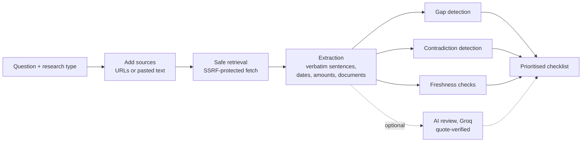
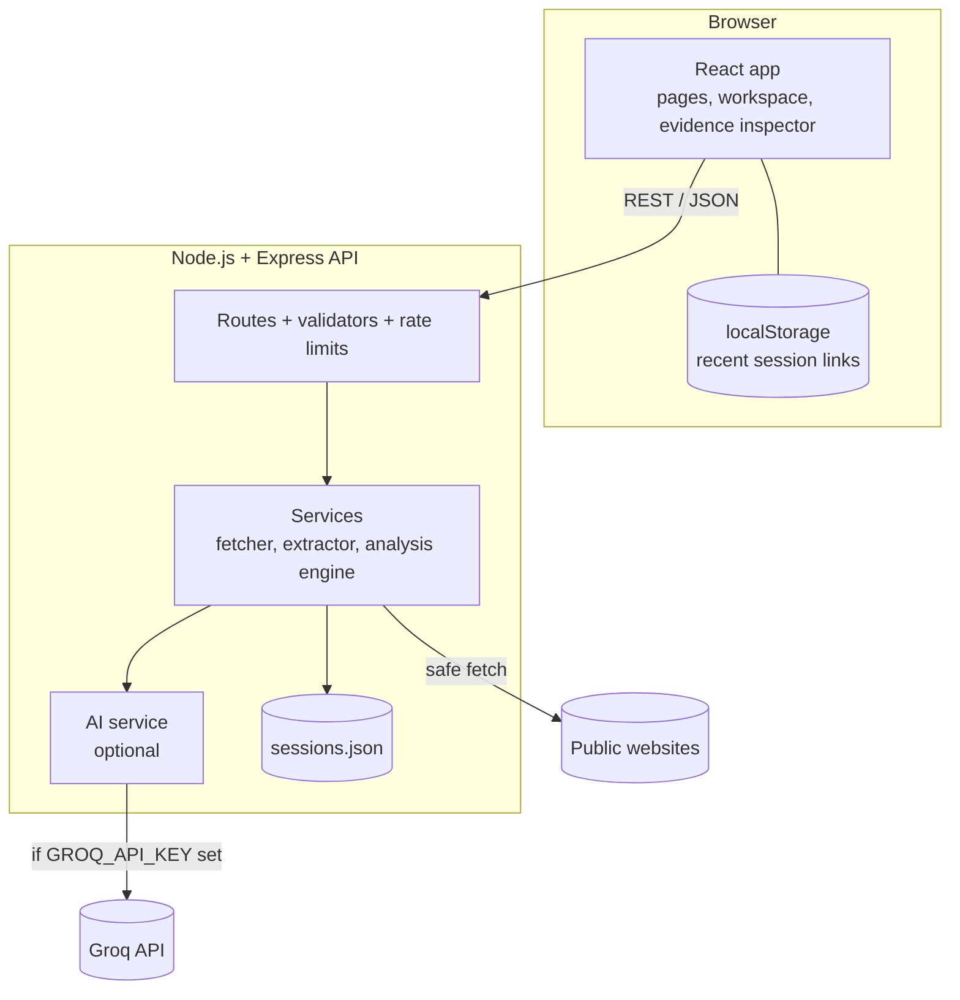

<div align="center">


# Digital Dark Spot

### Find what's missing from the information you trust.

An AI-assisted information gap detection platform that reviews the sources you collect and shows **what is missing**, **what conflicts**, and **what may be outdated**, with the evidence behind every finding.

Built for the **Shinchan Online Hackathon 2026** · Problem statement: *Digital Dark Spot*


-f55036)

</div>

<p align="center">
  
  <br />
  <sub>The research workspace running the built-in sample session (simulated sources).</sub>
</p>

---

## Table of contents

1. [The problem](#the-problem)
2. [The solution](#the-solution)
3. [Key features](#key-features)
4. [Demo walkthrough](#demo-walkthrough)
5. [How the analysis works](#how-the-analysis-works)
6. [What makes it different](#what-makes-it-different)
7. [Evidence and transparency](#evidence-and-transparency)
8. [Tech stack](#tech-stack)
9. [Architecture](#architecture)
10. [Project structure](#project-structure)
11. [Getting started](#getting-started)
12. [Environment variables](#environment-variables)
13. [API reference](#api-reference)
14. [Security](#security)
15. [Privacy](#privacy)
16. [Quality: testing, accessibility, SEO](#quality-testing-accessibility-seo)
17. [Known limitations](#known-limitations)
18. [Future scope](#future-scope)

---

## The problem

People make important decisions about scholarships, jobs, public services and research using information scattered across many websites. That information is often:

- **Incomplete**: eligibility is explained, but renewal conditions or the document list are not.
- **Contradictory**: an official notice and a blog give different deadlines or amounts.
- **Outdated**: a forum answer describes last year's application cycle.

Search engines help you *find* pages. Summarisers *condense* what the pages say. Neither tells you **what is missing**, **where sources disagree**, or **what you still need to verify** before you act.

## The solution

Digital Dark Spot turns a research question and a set of sources into a verification plan:

1. You ask a question, for example *"What should I verify before applying for this scholarship?"*
2. You add the pages you found: official notices, news, blogs, forums, or pasted text.
3. The server retrieves and reads each source, then extracts relevant statements word for word.
4. The analysis reports **potential gaps**, **possible contradictions** and **freshness warnings**.
5. Every finding becomes an item in a **prioritised checklist**, and every item links back to its evidence.

> Findings are prompts for verification, not verdicts. The platform says *"not found in the sources reviewed"*, never *"this does not exist"*.

## Key features

| Feature | What it does |
| --- | --- |
| **Research workspace** | Enter a question, choose a research type (scholarship, job, public service, research, general, or auto-detect), and manage up to 10 sources per session. |
| **Real source retrieval** | Fetches public web pages server-side, extracts readable text, titles and declared dates. Paste text for PDFs or pages that block automated access. |
| **Structured summary** | A coverage table shows which source mentions which topic, and extracted statements are grouped by topic with their source. |
| **Potential gap detection** | Lists topics the research type needs that no reviewed source covers, explains why each matters, and shows the exact search scope. |
| **Contradiction detection** | Compares deadlines, amounts, age and income limits, marks and required-document lists across sources, side by side with both quotes. |
| **Freshness warnings** | Flags old publication dates, deadlines that have passed, and undated pages, and explains the reason for each warning. |
| **Evidence inspector** | Click any citation to open the full retrieved text with the quoted passage highlighted, plus a link to the live page. |
| **Verification checklist** | Prioritised tasks (high, medium, low) with a rationale, related finding and sources. Tick items off, add your own; progress is saved. |
| **Optional AI review** | With a Groq key: a short summary, extra gap suggestions and a second opinion on conflicts. Clearly labelled and quote-checked. |
| **Sample session** | A one-click demonstration with three clearly labelled simulated sources that reproduce the scholarship scenario from the problem statement. |

## Demo walkthrough

The fastest way to see the full workflow is the built-in sample session:

1. Open the app and click **Open the sample session**.
2. Click **Run analysis**.
3. The results show:
   - **Potential gap**: renewal conditions are not found in the sources reviewed.
   - **Possible contradiction**: the official notice says the deadline is 31 December, the blog says 15 December.
   - **Document lists differ**: the notice asks for an income certificate, the blog mentions salary slips or an ITR.
   - **Possibly outdated**: the forum's closing date belongs to an earlier cycle and has passed; the blog was published over two years ago.
4. Click any **S1 / S2 / S3** citation to inspect the highlighted source passage.
5. Open the **Checklist** tab: confirm the current deadline, the official document list and the renewal policy.

> The sample sources are invented for demonstration and are labelled **Simulated** everywhere in the interface. To analyse real information, click **Start Research** and add real URLs.

## How the analysis works



| Stage | Implementation | Details |
| --- | --- | --- |
| **Retrieval** | `backend/src/services/fetcher.service.js` | Server-side fetch with DNS-pinned connections, redirect re-validation, 12 s timeout, 3 MB limit, HTML and plain text only. Failures are reported with a reason and never counted as reviewed. |
| **Extraction** | `backend/src/services/analysis/claims.js` | Sentences are tagged with topics (eligibility, deadline, amount, documents, renewal…). Dates, money (including lakh and crore), ages and percentages are parsed. Text is never paraphrased. |
| **Gaps** | `backend/src/services/analysis/gaps.js` | Each research type defines the topics it needs, with importance and a recommended verification step. Gaps record the sources searched and the wording looked for. |
| **Contradictions** | `backend/src/services/analysis/contradictions.js` | Values are compared only when each sentence states one explicit value. Differences explained by a different year or cycle, unit (monthly or yearly) or category are labelled separately from possible contradictions. |
| **Freshness** | `backend/src/services/analysis/freshness.js` | Uses only dates the page declares (meta tags, JSON-LD, `<time>`). Undated pages are shown as "Date unavailable", not as outdated. |
| **Checklist** | `backend/src/services/analysis/checklist.js` | Converts findings into prioritised tasks. Completion state survives re-analysis. |
| **AI review** | `backend/src/services/ai.service.js` | Optional. Source text is passed as delimited, untrusted data. Every AI key point must include a quote that is checked word for word against the source; unverifiable statements are discarded. |

## What makes it different

- **It reports absence, not just presence.** The core output is what the sources *don't* say, relative to what your type of decision needs.
- **Deterministic and explainable first, AI second.** The rule-based engine works without any AI key, and every finding can be traced to a sentence or a defined search scope.
- **Cautious about conflicts.** A different deadline in a different year is labelled *"may be a different cycle"*, not *"contradiction"*.
- **AI output is checked against the sources.** Quotes the model returns must exist in the retrieved text, or they are dropped.
- **Honest about coverage.** Every result shows how many sources and words were actually reviewed, and which sources could not be retrieved.

## Evidence and transparency

Every piece of text in the workspace carries a label:

| Label | Meaning |
| --- | --- |
| **Source text** | Copied word for word from a retrieved source. |
| **AI-generated, unverified** | Written by a language model (only when AI review is enabled). |
| **Quote verified in source** | An AI key point whose quote was found word for word in the source. |
| **Simulated** | Demonstration content that is not real. |
| **Date unavailable** | The page declares no date, so its currency is unknown. |
| **Limited / Moderate / Broader evidence** | How much text the finding is based on. |

Status is never communicated by colour alone; every tag carries text.

## Tech stack

| Layer | Technology |
| --- | --- |
| Frontend | React 19, Vite 8, React Router 7, plain CSS with design tokens (no UI framework) |
| Backend | Node.js 22, Express 5, Cheerio (HTML parsing), Helmet, CORS, express-rate-limit |
| AI (optional) | Groq API via the official `groq-sdk`, JSON mode, default model `openai/gpt-oss-120b` |
| Storage | JSON file with atomic writes (single-instance deployments) |
| Testing | Node.js built-in test runner |

## Architecture



- API keys exist **only** on the server. The frontend reads nothing but the public API URL.
- Sessions are identified by an unguessable 128-bit ID. There are no accounts.

## Project structure

```text
digital-dark-spot/
├── backend/
│   ├── server.js                  # Entry point: loads store, starts API, purges expired sessions
│   ├── src/
│   │   ├── app.js                 # Express app: security headers, CORS, JSON limits, routes
│   │   ├── config/                # Environment-based configuration and limits
│   │   ├── routes/                # /api/health, /api/research/...
│   │   ├── controllers/           # Request handling and response shaping
│   │   ├── services/
│   │   │   ├── fetcher.service.js     # SSRF-safe page retrieval
│   │   │   ├── extractor.service.js   # HTML → text, title, declared dates
│   │   │   ├── source.service.js      # Source lifecycle (retrieve, paste, status)
│   │   │   ├── store.service.js       # JSON-file persistence
│   │   │   ├── ai.service.js          # Optional Groq review with quote verification
│   │   │   ├── demo.service.js        # Clearly labelled simulated sample sources
│   │   │   └── analysis/              # profiles, claims, gaps, contradictions, freshness, checklist
│   │   ├── middleware/            # Rate limits, error handling
│   │   ├── validators/            # Server-side input validation
│   │   └── utils/                 # IP/URL safety, dates, text helpers
│   ├── test/                      # Unit and analysis tests
│   └── .env.example
├── frontend/
│   ├── index.html                 # Base metadata, Open Graph tags, favicon
│   ├── vite.config.js             # Generates sitemap.xml and robots.txt when VITE_SITE_URL is set
│   ├── public/                    # favicon.ico/svg, robots.txt, images (OG image, app preview)
│   ├── src/
│   │   ├── pages/                 # Home, Research, Workspace, Method, Privacy, Terms, 404
│   │   ├── components/            # UI primitives, forms, workspace (sources, findings, checklist, inspector)
│   │   ├── layouts/               # Site header, mobile navigation, footer
│   │   ├── hooks/                 # Session loading, page metadata, recent sessions
│   │   ├── services/              # API client (all backend calls go through here)
│   │   ├── styles/                # Design tokens, base, components, layout
│   │   └── utils/                 # Formatting and labels
│   └── .env.example
├── .gitignore
└── README.md
```

## Getting started

### Prerequisites

- **Node.js 22.9 or newer** (the backend uses `--env-file-if-exists`)
- npm

### 1. Start the backend (port 4000)

```bash
cd backend
npm install
cp .env.example .env    # then edit if needed
npm run dev
```

You should see:

```text
[api] Digital Dark Spot API listening on http://localhost:4000
[api] AI review: not configured (rule-based analysis only)
```

### 2. Start the frontend (port 5173)

```bash
cd frontend
npm install
cp .env.example .env
npm run dev
```

Open **http://localhost:5173**.

### 3. (Optional) Enable AI review

Add a Groq API key to `backend/.env` and restart the backend:

```env
GROQ_API_KEY=your_key_here
```

### Production build

```bash
# Backend
cd backend
npm install --omit=dev
npm start

# Frontend
cd frontend
npm run build          # outputs static files to frontend/dist
```

Deploy `frontend/dist` to any static host with a single-page-app fallback to `index.html`. Configure HTTPS at your hosting platform or reverse proxy, then set:

- `NODE_ENV=production`, `FRONTEND_ORIGIN=<your frontend URL>` and `TRUST_PROXY=1` (if behind a proxy) in the backend
- `VITE_API_BASE_URL=<your API URL>` and `VITE_SITE_URL=<your frontend URL>` in the frontend, before building

## Environment variables

### Backend (`backend/.env`)

| Variable | Default | Description |
| --- | --- | --- |
| `PORT` | `4000` | Port the API listens on |
| `NODE_ENV` | `development` | `production` enables HSTS |
| `FRONTEND_ORIGIN` | `http://localhost:5173` | Comma-separated list of origins allowed by CORS |
| `TRUST_PROXY` | `0` | Number of reverse proxies in front of the API (for accurate rate limiting) |
| `SESSION_RETENTION_DAYS` | `30` | Sessions unchanged for this many days are deleted automatically |
| `GROQ_API_KEY` | *(empty)* | Enables the optional AI review layer |
| `GROQ_MODEL` | `openai/gpt-oss-120b` | Any Groq chat model that supports JSON mode |

### Frontend (`frontend/.env`)

All values are public and bundled into the browser. **Never put secrets here.**

| Variable | Default | Description |
| --- | --- | --- |
| `VITE_API_BASE_URL` | `http://localhost:4000` | Backend API URL |
| `VITE_SITE_URL` | *(empty)* | Deployed frontend URL. Enables canonical and Open Graph URLs and `sitemap.xml` generation. |

## API reference

Base URL: `http://localhost:4000/api`

| Method | Endpoint | Description |
| --- | --- | --- |
| `GET` | `/health` | Service status, engine version, whether AI is configured |
| `POST` | `/research` | Create a session. Body: `{ "question": string, "profile": "auto" \| "scholarship" \| "job" \| "publicService" \| "research" \| "general" }` |
| `POST` | `/research/demo` | Create a sample session with simulated sources |
| `GET` | `/research/:id` | Get a session (sources, analysis, checklist) |
| `PATCH` | `/research/:id` | Update the question or research type |
| `DELETE` | `/research/:id` | Delete a session |
| `POST` | `/research/:id/sources` | Add a source: `{ "type": "url", "url": string }` or `{ "type": "text", "title": string, "text": string, "originUrl"?: string }` |
| `GET` | `/research/:id/sources/:sourceId` | Get a source including its full extracted text |
| `POST` | `/research/:id/sources/:sourceId/retry` | Retry a failed retrieval |
| `DELETE` | `/research/:id/sources/:sourceId` | Remove a source |
| `POST` | `/research/:id/analyze` | Run the analysis |
| `GET` | `/research/:id/findings` | Get the latest analysis |
| `GET` | `/research/:id/checklist` | Get the checklist |
| `POST` | `/research/:id/checklist` | Add your own item: `{ "text": string, "priority": "high" \| "medium" \| "low" }` |
| `PATCH` | `/research/:id/checklist/:itemId` | Mark done or not done: `{ "done": boolean }` |
| `DELETE` | `/research/:id/checklist/:itemId` | Delete an item you added |

Errors use a consistent shape and appropriate HTTP status codes:

```json
{ "error": { "code": "validation_error", "message": "Please correct the highlighted fields.", "fields": { "url": "..." } } }
```

## Security

- **Secrets stay on the server.** The Groq key is read only by the backend; the frontend bundle contains no credentials.
- **SSRF protection** for URL retrieval:
  - only `http`/`https` on ports 80 and 443; no embedded credentials
  - blocks `localhost`, internal hostnames and alternate IP spellings
  - every connection is pinned to a DNS result that is checked against private, loopback, link-local (including `169.254.169.254` cloud metadata), CGNAT, reserved and multicast ranges, for both IPv4 and IPv6 (including IPv4-mapped and NAT64 addresses)
  - every redirect target is re-validated
- **Hardened API**: Helmet security headers with a strict CSP, CORS allow-list, 200 KB JSON body limit, per-route rate limits, `Cache-Control: no-store`, centralised error handling that never leaks stack traces.
- **Input validation** on the server for every route; a honeypot field on session creation deters bots.
- **Untrusted content handling**: retrieved text is rendered as text (never as HTML), links are restricted to `http`/`https` with `rel="noopener noreferrer nofollow"`, and source text sent to the AI is delimited and explicitly marked as data, not instructions.
- **No sensitive logging**: research questions and source text are not written to logs.

## Privacy

- **No accounts, no cookies, no analytics or trackers.**
- Sessions are stored on the server and identified by a long random link; anyone with the link can open it.
- Sessions unchanged for `SESSION_RETENTION_DAYS` (30 by default) are deleted automatically, and users can delete a session at any time.
- The browser keeps a local list of the sessions opened on that device, which can be cleared from the Privacy page.
- When AI review is enabled, the question and source text are sent to Groq during analysis.
- The in-app **Privacy policy** and **Terms of use** describe the actual behaviour and are marked **DRAFT: REVIEW REQUIRED** for operator details and legal review.

## Quality: testing, accessibility, SEO

### Tests

```bash
cd backend
npm test
```

The test suite covers:

- SSRF protection: blocked and allowed IP ranges, unsafe URL rejection
- Parsing of dates, money (lakh and crore), ages, and sentence splitting
- HTML extraction of declared dates and removal of scripts
- The full analysis on the sample session: renewal gap, deadline and amount contradictions, document-list difference, cycle-explained difference, stale and past-deadline warnings
- Checklist completion surviving re-analysis
- No contradictions invented from irrelevant text

The complete user journey was also exercised in headless Chrome, including source retrieval, analysis, evidence inspection, checklist persistence, mobile navigation and the 404 page. It was checked for horizontal overflow at 320, 375, 390, 768, 1024 and 1440 px.

### Accessibility

- Semantic landmarks, skip link, logical heading order
- Every form field labelled; inline errors linked with `aria-describedby`
- Visible focus styles; keyboard-operable tabs (arrow keys), dialog (Esc) and mobile menu
- Asynchronous status announced through live regions
- Status never conveyed by colour alone; `prefers-reduced-motion` respected

### SEO

- Unique title and description for every public route; private session pages are `noindex`
- Open Graph and Twitter card metadata with a 1200×630 preview image
- `favicon.ico`, SVG favicon and Apple touch icon
- `robots.txt` (session URLs disallowed) and `sitemap.xml` generated at build time when `VITE_SITE_URL` is set
- Route-level code splitting; the hero image is a compressed WebP with explicit dimensions

## Known limitations

- **No web search integration.** Users add sources themselves; no search API is configured.
- **PDF files are not parsed.** Their text can be pasted as a source.
- **Keyword-based gap detection.** Information phrased differently can be missed; every gap states this and shows its search scope.
- **JavaScript-rendered pages** may yield too little text and are reported as not retrieved.
- **JSON-file storage** suits a single server instance; multi-instance deployments need a database.
- **English-language patterns.** Extraction rules are written for English text.

## Future scope

- Integration with a permitted search API to collect sources automatically
- PDF and document parsing
- Hindi and regional-language extraction
- Detection of official domains to rank authoritative sources first
- Optional accounts for private, cross-device session history
- Export of findings and checklists as PDF or shareable reports

---

<div align="center">
<sub>Digital Dark Spot · Shinchan Online Hackathon 2026 · Not affiliated with the Crayon Shin-chan franchise.</sub>
</div>
